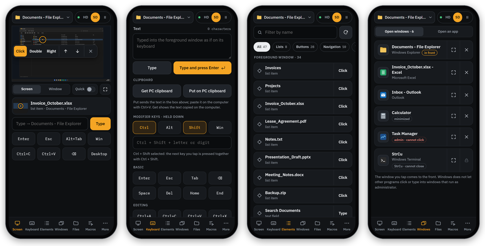
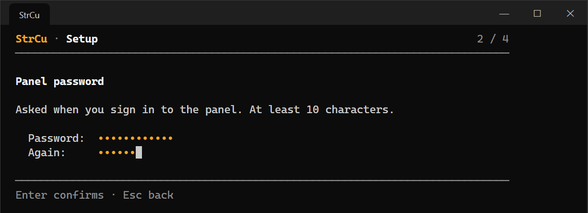
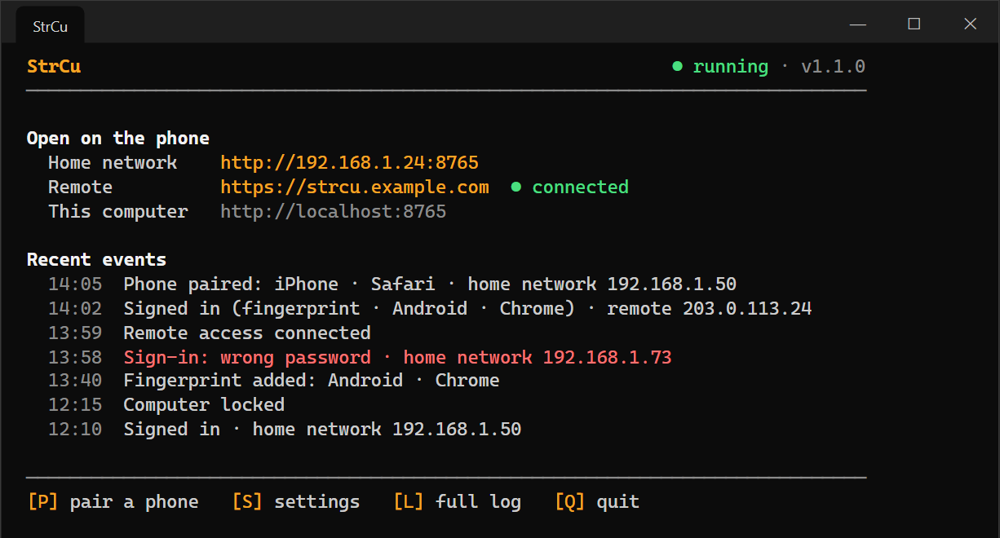
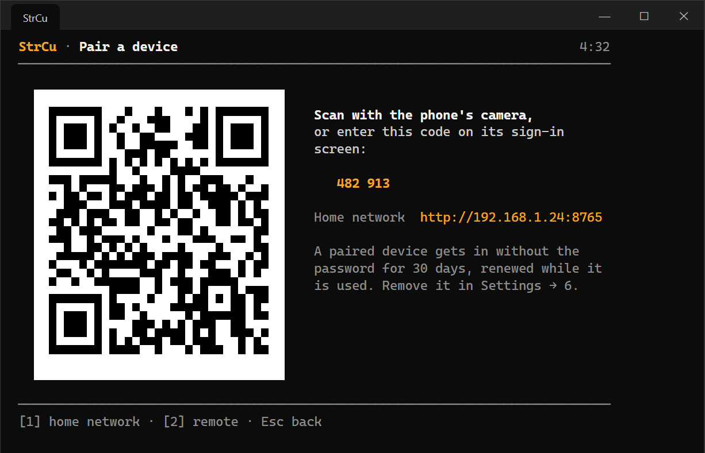
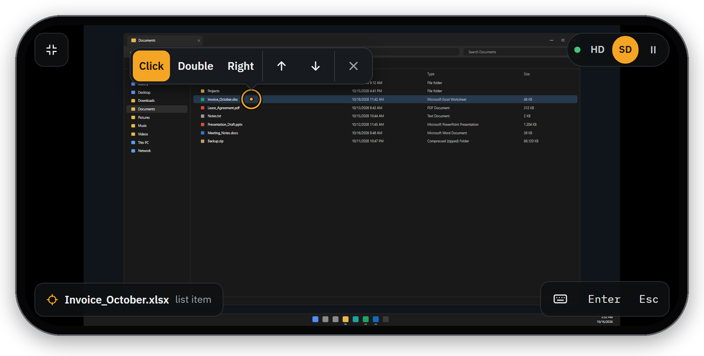
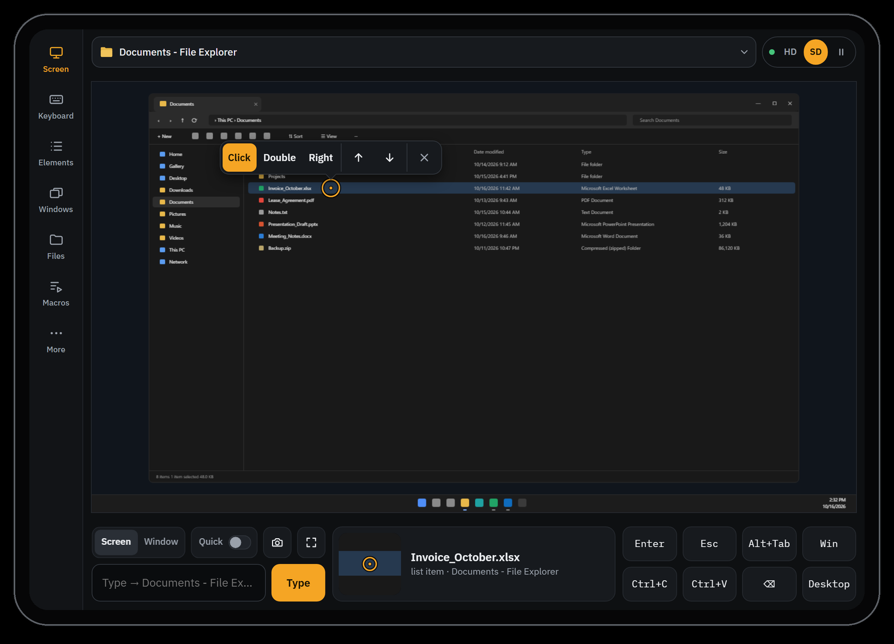
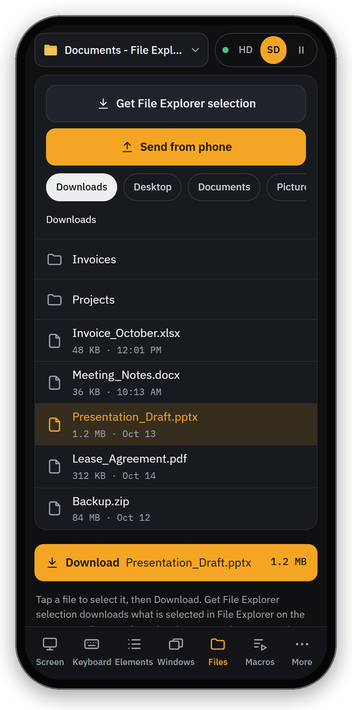
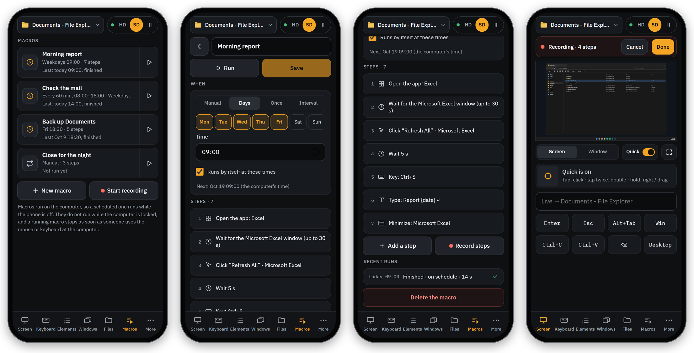

# StrCu

**Control your Windows PC from your phone, a tablet or another computer.**

When you are away from the desk, StrCu replaces calling someone at home and talking them through "open that
program, click there". It is a single exe that serves a web panel, made for the phone first; whatever opens it
needs nothing but a browser.

<p align="center">
  
</p>

- **See the screen live**, mouse pointer included: only what changes is sent, so a still screen uses no data.
  Tap to aim a crosshair; then click, double-click, right-click, scroll or type. Or switch on **Quick**: a tap
  clicks, two taps double-click, a long press right-clicks or drags, and what you type goes to the computer key
  by key.
- **Keyboard:** type text into the foreground window, send shortcuts (Ctrl / Alt / Shift / Win held for the next
  key), F1–F12; get the computer's clipboard text or put text on it.
- **Know what you are about to click.** Windows' own accessibility data (UI Automation) names the element under
  the crosshair and lists everything clickable in the window. No AI, no GPU, no extra install.
- **Nothing on the screen is out of reach.** The lock screen, the Windows sign-in screen, the "do you want to
  allow this app" prompt and windows running as administrator come through like any other window, keyboard
  included - so a computer that is locked, or that nobody has signed in to yet, is still yours from the phone.
  Your own things - apps, files, the clipboard - are done as you, never as the computer.
- **Windows and apps:** bring a window to the front, maximize or close it; open any app from the Start menu.
- **Files:** download from Downloads, Desktop, Documents, Pictures and Videos, or the file selected in File
  Explorer; send files into the computer's Downloads.
- **Macros:** record what you do in the panel or build the steps yourself (clicks, keys, text, apps, windows,
  waits, repeats), then run them by hand or on a schedule.
- **Phone first, tablets and computers too:** on a tablet or in a wide browser window the screen image fills the
  page and every control stays in view; a mouse taps, holds and drags like a finger.
- **On your home Wi-Fi** out of the box, and **from anywhere** through a free Cloudflare Tunnel if you want.
- **Sign in** with a password, pair a device once with a QR code, or use a passkey (fingerprint / Face ID).
- English and Turkish.

## Install

In PowerShell (Windows 10 or 11). It asks for administrator approval once:

```
irm https://github.com/sakirsek/strcu/releases/latest/download/install.ps1 | iex
```

It downloads the latest release, checks its SHA-256 checksum, installs it to `%ProgramFiles%\StrCu`, sets it
up as a Windows service, adds StrCu to the Start menu and the desktop, and opens the first-start setup. The
settings live in `%ProgramData%\StrCu`, which only administrators may write to; the installer makes sure of
that before anything goes in, and a folder of that name left by anyone else is moved aside rather than used.
An older StrCu's settings are copied over while installing - the password, paired devices, passkeys, macros
and the tunnel - so nothing has to be set up again, and what that older install kept is left where it was. Running the same
line again updates StrCu (settings stay).

To remove StrCu with all its settings, shortcuts and its service, uninstall it in **Settings → Apps → Installed
apps**, or in StrCu's own settings (**S**, then **9**); both ask for administrator approval and run a copy of the
installer kept in `%ProgramFiles%\StrCu`. The same from PowerShell:

```
& ([scriptblock]::Create((irm https://github.com/sakirsek/strcu/releases/latest/download/install.ps1))) -Uninstall
```

The exe can also be downloaded by hand from [Releases](https://github.com/sakirsek/strcu/releases), next to its
`strcu.exe.sha256`. It is not code-signed, so Windows SmartScreen may stop it with "Windows protected your PC":
choose **More info → Run anyway**. The one-line install does not meet this, since files PowerShell downloads
are not marked as coming from the internet.

## First start



StrCu opens in a terminal window. The first start is a short setup:

1. **Language** (Windows' display language is offered first).
2. **Panel password**, at least 10 characters (kept as an argon2 hash).
3. **Home network:** whether devices on your Wi-Fi may reach the panel. Windows then asks once whether StrCu may
   accept connections; with "Private networks" selected, choose Allow.
4. **Remote access** through Cloudflare, optional and possible later ([below](#remote-access-optional)).

StrCu itself starts with Windows, before anyone signs in, and keeps running when you sign out. Nothing is
asked about that, because the service is what StrCu is.



After that the main screen shows where the phone can open the panel and the important events: sign-ins and
failed attempts with where they came from, devices paired, fingerprints added, the computer locked, files sent or
received, the clipboard read, the tunnel coming and going. **P** pairs a device, **S** opens the settings
(language, password, home network, remote access, this install, paired devices and fingerprints, port, stop,
uninstall),
**L** shows the full log and **Q** closes the window.

The window is a window onto the StrCu that is running, not StrCu itself: closing it leaves the panel and the
tunnel as they are, and opening it again shows the same StrCu. Settings → **This install** says how StrCu
starts and where it keeps things; Settings → **Stop StrCu** stops it until the computer starts again. While
StrCu runs, the computer does not go to sleep (the display may still turn off). For a laptop that works with
its lid closed, set Windows to do nothing when the lid is closed.

## Connect a phone



Press **P** on the main screen and scan the QR code with the phone's camera, or open the address shown and type
the six-digit code under "Pair with a code from the computer". The paired phone gets in without the password
for 30 days, renewed while it is used. The password works too, from any browser.

The phone and the computer must be on the same Wi-Fi, and Windows must count that network as *Private*: on a
*Public* network (café, hotel) home network access turns itself off. To change it: Settings → Network &
internet → Wi-Fi → your network → Network profile type → Private.

## The panel

Seven tabs: Screen, Keyboard, Elements, Windows, Files, Macros, More.

- **Top bar:** the foreground window with its app icon; tap it for the list of open windows. Shows when the
  computer is locked. Next to it, the live view controls (HD / SD / ❚❚) with a dot: green while the image is
  live, red when it is paused or when the image in view lags.
- **Screen:** a tap aims the crosshair; a bar with Click / Double / Right, ↑ / ↓ (scroll) and ✕ appears next to
  it. Below the image, a magnifier and the element's name. A typing box and eight common keys sit underneath.
  When the lock screen, the sign-in screen or an approval prompt is in front, a line above the image says so,
  with one key that wakes a screen that went dark and brings the PIN box up.
- **Quick** (the switch under the image) skips the crosshair. A tap clicks, a quarter of a second later in case
  a second tap follows; two taps double-click. Hold a finger still for half a second: lifting it right-clicks,
  moving it drags with the left button held. If the phone loses its connection mid-drag, StrCu lets go of the
  button by itself after three seconds. The typing box gives way to a keyboard button (next to the switch): it
  opens the phone keyboard, and each key goes to the computer as it is pressed. The keyboard's corrections and
  suggestions come out right on the computer, and Enter presses Enter. A hardware keyboard (a tablet's) needs
  no button: its keys, shortcuts included, go straight to the computer. A mouse works as the computer's own:
  moving it moves the computer's pointer, its buttons press and let go there (a click, a double-click, a drag,
  a right- or middle-click) and the wheel scrolls under the pointer. Moving it does nothing while a macro runs.
- **Screenshot** (the camera button, also in full screen): the screen, or the window in the window view, at
  full size and without the pointer goes onto the computer's clipboard and onto the device's, to paste on
  either. Browsers let a page put a picture on the device's clipboard only over https (the tunnel); on the home
  network it goes onto the computer's alone, and the panel says so.
- **Live view:** SD scales the long side to 1280 pixels, HD sends full resolution. The computer looks at the
  screen several times a second and sends only the parts that changed, as JPEG pieces, and nothing while the
  screen is still. While something keeps changing (scrolling, a video) the pieces are a little softer, and they
  come again sharp once it holds still. Each frame waits for the phone to draw the one before, so a slow
  connection gets fewer frames rather than a growing delay. The mouse pointer is drawn in. ❚❚ freezes the image;
  on the other tabs nothing is sent. Where WebSocket is not available (an old browser, a proxy in the way) the
  image is fetched every 2.5 s instead.
- **Keyboard:** a text box (types into the foreground window), modifier keys held for the next key, common keys,
  arrows, F1–F12 and recent shortcuts. **Clipboard:** *Get PC clipboard* shows the text copied on the computer,
  and *Copy here* copies it on your side; *Put on PC clipboard* sends the text in the box, to paste on the
  computer with Ctrl+V.
  Only when asked, never on its own (it may hold a password just copied).
- **Elements:** named clickable elements of the foreground window and the taskbar, filterable by name and kind.
- **Windows:** open windows with their app icons; bring to front, maximize or close. **Open an app** lists the
  Start menu apps (classic and Store) with search and recent apps.
- **Files:** files to the phone and from it ([below](#files)).
- **Macros:** the macros, their schedules and last runs ([below](#macros)).
- **More:** session and sign-out, passkeys, lock and shut down (with a 15 s countdown that can be cancelled),
  panel language, the data used and a log of what was done. **Data used** shows what StrCu sent to the phone and
  got from it in this session, through the tunnel and on the home network, with the total under them and the
  share of the live view, files and the rest. It counts StrCu's own data, so the phone's own figure comes out a
  little higher (encryption, headers); it starts over when StrCu restarts.

**Full screen:** ⛶ or turn the phone sideways. Pinch to zoom, drag to pan, tap to aim. At the bottom right, the
keyboard button and the Quick switch. With Quick on, taps and long presses work as above, a quick drag still
pans the zoomed image, and the keyboard button opens the phone keyboard. A mouse works as above, and Ctrl+wheel
zooms.

On an iPhone a web page can neither fill the screen nor turn itself sideways, so ⛶ on a phone held upright
turns the full screen instead: turn the phone to the left, with rotation lock on or off. While the keyboard is
open, it stands upright.



**Tablets** (and wide browser windows): the Screen tab fills the page and the image takes all the room the
controls leave. Held sideways, the tabs move to a rail on the left and the controls sit in one row under the
image: view and Quick, the typing box (with Quick on, the keyboard button), the element under the crosshair
with a larger magnifier, and the keys. Held upright, the image spans the full width with the controls at the
bottom. The other tabs stay a readable column in the middle.



The page loads nothing from outside; its fonts (IBM Plex) are built in.

### Files

On the Files tab:



- **From the computer:** the Downloads, Desktop, Documents, Pictures and Videos folders (wherever Windows keeps them,
  OneDrive included), folders first and then the newest files. A tap selects a file and **Download** under the
  list, showing its name and size, gets it; so a wrong tap costs no data. **Get File Explorer selection**
  downloads what is selected in File Explorer on the computer; with several selected, a list to choose from.
- **To the computer:** **Send to computer** puts files into Downloads. They travel in 4 MB pieces, so large files
  get through the tunnel too (Cloudflare takes at most 100 MB a request), and keep a temporary name until they
  are complete. A file of the same name is never replaced: the new one becomes `photo (1).jpg`.

The panel opens nothing outside those folders: no `..`, drive letters or links that lead out. Every file sent
either way is logged and shown on the computer's main screen.

### Macros



A macro is a list of steps that StrCu runs in order on the computer:

- **Mouse:** click, double-click or right-click, scroll, or drag from one element to another.
- **Keyboard:** type text (`{date}` and `{time}` are filled in when it runs), press a key or shortcut a number
  of times.
- **Apps and windows:** open a Start menu app, a file, a folder or a web page; bring an app's window to the
  front, maximize, minimize or close it.
- **Waits:** a number of milliseconds, until an app's window opens, or until an element appears.
- **Flow:** repeat the steps before it a number of times, or run another macro.
- **As the last step:** lock the computer or shut it down.

An element is found again the way a person would find it: its app's window comes to the front, then the
element is looked up by its name (the one nearest to where it was, if there are several); without a name, the
same point in the window is used. Such a step is set on the live screen: aim at the element and tap
**Choose**. Each step can be tried on its own, and a step can be set to let the macro go on if it fails.

**Start recording** turns what you do in the panel into steps: taps and drags, keys, text (typed live it
becomes one step, corrections left out), apps opened (with a wait for their window), windows brought to the
front, maximized or closed. A red bar shows how many steps there are; **Done** adds them to a macro, where they
can be edited. Nothing done while Windows has the screen to itself - the lock screen, the sign-in screen, an
administrator approval - goes into a recording, so a PIN typed there is never kept; the panel says so once.

**How it runs:** each step starts as soon as the one before it is done; where the computer needs time, a wait
step gives it. A step that looks for an element by its name waits for it by itself, for a few seconds. The
steps run one after the other a set number of times, 1000 at most, with a wait between rounds if wanted.
**Stop** ends all of them.

**When:** by hand, on chosen days at a time, once at a date and time, or every so many minutes between two
times on chosen days. Schedules use the computer's clock and run on the computer, so the phone can be off.
The pause button in the list stops a schedule: the macro does not run by itself until it is turned back on.
A scheduled start is skipped and logged when the computer is locked, someone is using it at that moment, or
another macro is running or being recorded. A run stops as soon as someone uses the mouse or keyboard at the
computer or uses the panel; a step that fails stops it too, and a screenshot of that moment is kept with the
macro. Each macro lists its last runs. Macros are kept in `%ProgramData%\StrCu\macros.json`.

### What it cannot do

- Turn the computer on. It has to be running; StrCu can lock it or shut it down, not wake it from off.
- Send Ctrl+Alt+Del. Windows keeps that key for the person at the keyboard, and StrCu does not change the
  Windows settings that would let a program send it.
- Run a macro while the computer is locked. It could, but a macro that types into a locked computer is not
  something to start by a timer: a scheduled run is skipped and written to the log instead.
- Show what Windows itself hides. Video with copy protection comes out black: the picture is taken the way
  Windows hands the desktop over.

## Remote access (optional)

From outside the home, the panel is reached through a Cloudflare Tunnel protected by Cloudflare Access. You need
a Cloudflare account and a domain whose DNS is on Cloudflare; the tunnel and Access are free. cloudflared is
StrCu's own child process: StrCu watches its connection, starts it again if it stops, and closes it with the
panel. Nothing is installed for it.

cloudflared is kept up to date, since its releases carry its security fixes. Setting up remote access downloads
Cloudflare's newest release from GitHub, and a couple of minutes after StrCu starts and every six hours, StrCu
looks for a newer one. A release is taken only if it matches the SHA-256 in its release notes and Windows finds
it signed by Cloudflare. A newer one replaces the running one once nobody has used the tunnel for five minutes;
if it does not connect within a minute, the version before it comes back and that release is not tried again.
When the newest release cannot be taken during setup, StrCu downloads the version it was tested with, checked
against the SHA-256 built into StrCu. The log says what happened.

It is set up from the terminal (in the first-start setup, or Settings → Remote access), which walks through the
Cloudflare dashboard and checks each step:

1. cloudflared is downloaded and kept beside StrCu in `%ProgramFiles%\StrCu\cloudflared`, where only
   administrators may write. Before every start it is checked against the SHA-256 of the version StrCu took. A
   copy that does not match is never run; StrCu downloads the right one again.
2. **Tunnel:** Networking → Tunnels → Create a tunnel. The install command it shows is pasted into StrCu,
   not run. StrCu starts the tunnel at once, so the dashboard sees it connect and lets you go on.
3. **Address:** on the tunnel's Routes tab, Add route → Published application, with the Service URL
   `http://localhost:8765` (the port StrCu shows).
4. **Access:** Zero Trust → Access controls → Applications → Create new application → Self-hosted and private,
   for that address, with a policy that allows your email. StrCu opens the address and reads the team domain
   and the application's AUD tag from Access's own sign-in redirect; if Access is missing it says so.
5. The allowed email.

A remote request passes three gates: Cloudflare Access (email + one-time code), then StrCu's own check of the
Access token on every request (signature, AUD, email), then the panel password, a paired phone or a passkey.
Without Access settings the tunnel does not open at all.

Remote access is HTTPS, so passkeys work there: the phone signs in with its fingerprint or face instead of the
password (added under More, which asks for the password once).

## Who can get in

Every request is placed by where its connection really comes from (the socket's addresses and, for one from
this computer, the program that opened it), not only by its headers.

- **This computer:** a browser here signs in with the panel password like any other, and gets an ordinary
  session. StrCu runs with the rights of the computer, so a program on this computer that was let in without
  signing in would be handed those rights. Only `localhost` as the address: a site that points its own name at
  127.0.0.1 is treated as remote (DNS rebinding).
- **Home network** (when turned on): private addresses (192.168.x, 10.x, 172.16-31.x) on a network Windows
  counts as *Private*. The address typed must be the computer's IP or its name. Sign-in with the panel password
  or a paired phone. The connection is plain HTTP, so anyone on the same Wi-Fi could read it; browsers offer no
  passkeys there.
- **Remote:** through the Cloudflare tunnel, above. Connections opened by cloudflared always count as remote.
- **Anything else** is refused, with the reason shown in the visitor's language and written to the log (once a
  minute per address).

Five wrong passwords lock that source out for five minutes; each address has its own count, so a guesser on
the home network cannot lock out remote sign-in. A password or passkey session lasts 12 hours.

Until the first password is set, StrCu lets no one in. That first password is set from StrCu's window on this
computer - the installer opens its setup at the end for this - and, since there is nothing yet to check it
against, any program the signed-in person runs could set it too; so set it right away. After that, changing it
needs the current password, or an administrator (`strcu passwd`, below).

Pairing (`src/pair.rs`): the code is open only while its screen is shown, for five minutes, works once, and
closes after five wrong tries. The QR code carries it after `#`, which browsers never send to the server, and
the panel removes it from the address at once. The paired device's `HttpOnly` cookie works only at the address
it was paired on, and only a SHA-256 hash of its secret is kept. Remove a device in Settings → 6, or from the
device itself with "Unpair" under More.

Passkeys (`src/passkey.rs`): the private key never leaves the phone; StrCu keeps the public key and checks the
one-time challenge, origin, site hash, user verification, ES256 signature and signature counter. No attestation
is requested; adding a key requires the panel password instead.

The port is held for StrCu alone (`SO_EXCLUSIVEADDRUSE`), so no other program can listen on 127.0.0.1 at the
same port and receive this computer's connections, the tunnel's among them.

Browsers let any site open a WebSocket to any address, so the live view's WebSocket accepts only the panel's own
page (its Origin must match the address): a site open on this computer cannot watch the screen.

## Command line

```
strcu                             # the terminal app: setup on the first start, then the main screen
strcu passwd [--stdin]            # change the panel password through the running StrCu
strcu tunnel status               # remote access as the running StrCu sees it
strcu doctor [--json]             # what StrCu sees of this computer
strcu licenses                    # licenses of the third-party software built in
strcu serve [--bind 127.0.0.1:8765] [--no-tunnel]   # StrCu without the service, status lines only
```

`strcu passwd` asks for the current password, then the new one, which holds at once and signs every phone
out; with `--stdin` they come one per line. In a terminal run as administrator it sets a new password without
the old one, which is the way back from a forgotten password. Remote access is set up in the window
(Settings → 4).

`strcu serve` is for a computer without the service, such as a development build. Where the service is
installed StrCu is already running, so `serve` refuses, and `strcu` started with no terminal writes out what
the running StrCu is doing instead of starting a second one.

`strcu service`, `strcu worker` and `strcu agent` are the three parts StrCu runs itself: Windows starts the
service, the service starts a worker on the screen's session, and the worker starts an agent with the signed-in
user's own rights. They are not meant to be started by hand.

Developer tools drive the operating system layer directly (coordinates are physical pixels everywhere):

```
strcu dev shot -o screen.jpg --max-side 1280
strcu dev elements [--all]        # visible clickable elements (UI Automation)
strcu dev find "Save" --click     # find by name and click (--double)
strcu dev at 689 919              # element at a point
strcu dev click 689 919 --button right
strcu dev type "Unicode text: şğüöçıİ é ß"
strcu dev key ctrl+shift+esc
strcu dev windows | focus <name> [--maximize] | close <name>
strcu dev apps                    # apps in the Start menu
strcu dev launch "Calculator"     # launch an app (full or partial name)
strcu dev lockstate | lock | awake [--display]
strcu dev shutdown [--secs 15] | shutdown --cancel
strcu dev preview --lang tr       # every terminal screen with made-up data, as HTML pages
```

## Build from source

With [Rust](https://rustup.rs) (the MSVC toolchain) on Windows:

```
cargo build --release
target\release\strcu.exe
```

## Languages

The panel follows the phone's language and can be switched under More; the terminal's language is chosen in
the setup and changed in Settings. Every text lives in `lang/<code>.json`, shared by the panel and the
terminal; a language is added by adding a file (the `_name` key holds its own name, `{name}` placeholders are
filled in, `{"one": ..., "other": ...}` gives plural forms). The tests check that every file has the same keys
and placeholders as `lang/en.json`.

## Layout

- `src/svc.rs` the Windows service, which keeps a worker running on the session that has the screen;
  `src/agent.rs` the part that runs with the signed-in user's own rights, for their apps, files and clipboard;
  `src/paths.rs` the settings folder and who may write there
- `src/sys/` operating system layer (screen, input, windows, UI Automation, clipboard, File Explorer, power,
  apps, icons, discovery, child processes, the desktop in front)
- `src/server/` + `src/web/` the panel: who gets in (`mod.rs`, `via.rs`, `signin.rs`), the page, and the
  endpoints by what they do (`control.rs`, `desktop.rs`, `transfer.rs`, `automation.rs`); `src/worker.rs` runs
  operating system work in order on one thread; `src/log.rs` the log of what was done
- `src/stream.rs` the live view stream (changed tiles as JPEG pieces); `src/files.rs` files to and from the phone;
  `src/usage.rs` the data used, per sign-in
- `src/macros/` macros: steps and storage, schedules, the runner and recording
- `src/app.rs` what runs while StrCu is open (listener, tunnel watcher); `src/tui/` the terminal screens, plain
  functions from state to frames that the terminal draws and `strcu dev preview` turns into HTML
- `src/auth.rs` sign-in, `src/pair.rs` paired phones, `src/passkey.rs` passkeys, `src/access.rs` Cloudflare
  Access verification
- `src/i18n.rs` + `lang/` languages; the server sends message keys, the panel and the terminal render them
- `src/tunnel/` cloudflared management and updates, `src/download.rs` downloads verified with SHA-256,
  `src/sys/sign.rs` signature checks
- `install.ps1` the one-line installer; `.github/workflows/` CI, releases and the third-party notices check

## Support

StrCu is free and open source. If it saves you a phone call home, you can support its development through
[GitHub Sponsors](https://github.com/sponsors/sakirsek).

## License

MIT, see [LICENSE](LICENSE). The software built into strcu.exe and its licenses are listed in
[THIRD-PARTY-NOTICES.txt](THIRD-PARTY-NOTICES.txt) (made with cargo-about, see `about.toml`), which
`strcu licenses` also prints. The live view's JPEG encoding is based in part on the work of the Independent
JPEG Group. The embedded IBM Plex fonts are under the SIL Open Font License
([src/web/fonts/OFL.txt](src/web/fonts/OFL.txt)). cloudflared, downloaded when remote access is set up, is
Cloudflare's, under the Apache License 2.0.

The screenshots show made-up data.
